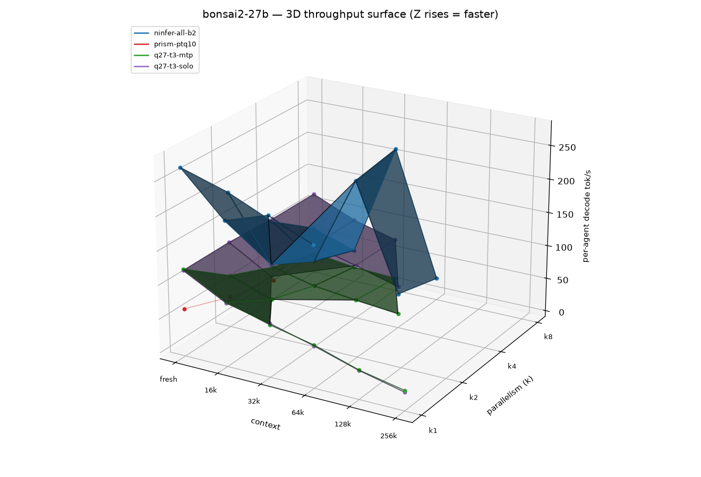
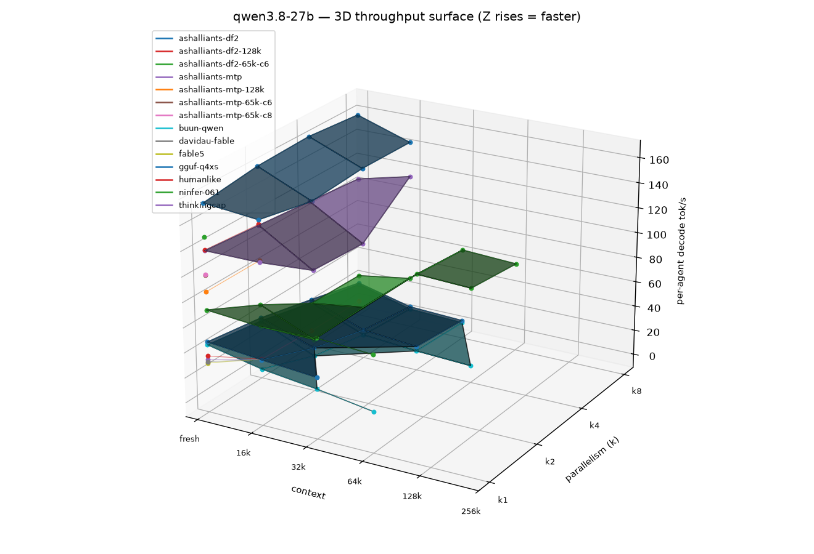
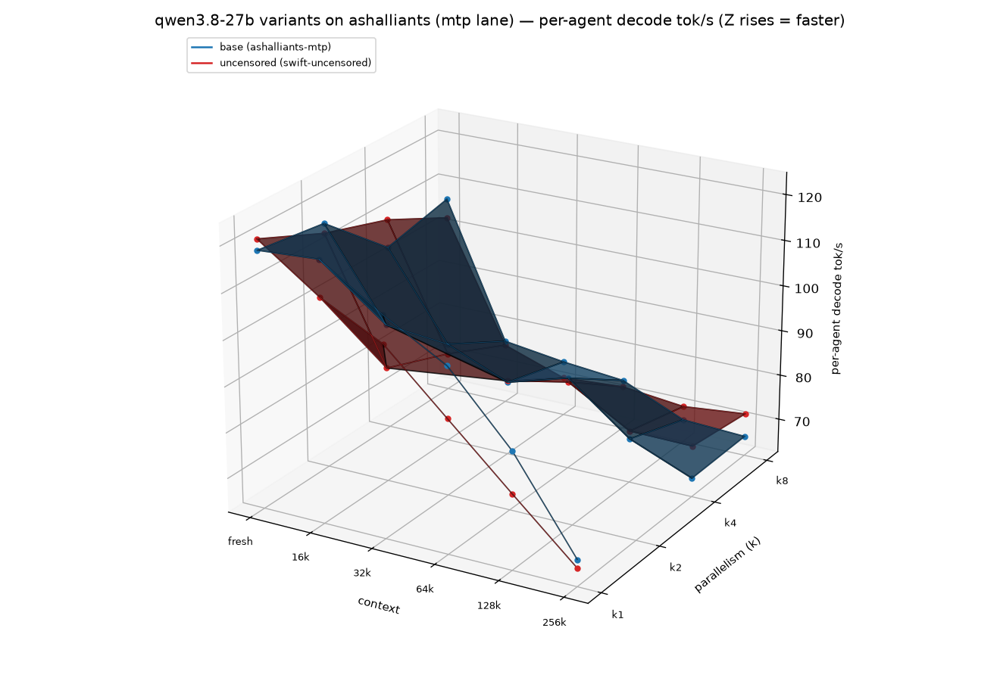

# Inference engine benchmark — RTX 3090 (TB4 eGPU, SM86, 24 GB)

_Generated 2026-10-10 · harness: `benchmarks/engines-2026-10/` · metric: **per-agent decode tok/s** (chars/4.1 streaming proxy, engine-validated 2026-10-08) · greedy, 256 max tokens · GPU-resident weights/KV only (no CPU offload)._

## Summary

Sweep screened 10 engine configurations across two model families on one RTX 3090 (TB4 eGPU): screening (fresh + 16k, C1–C8) then a long ladder (32k–256k, C1/C4/C8) for survivors. Metric is per-agent decode tok/s: what one agent observes while N agents stream concurrently on the same engine. Cells that overflowed the 15 GiB host or deadlocked the engine are ledgered, not averaged in. Peak VRAM per cell is reported beside each table.


Per-engine sections below pair each engine's configuration with its result table: per-agent decode tok/s (rows = context, cols = C1–C8) and peak VRAM MiB per cell. `—` = not measured or overflow (see ledger).

### Throughput surfaces

Z = per-agent decode tok/s (up = faster), X = context, Y = parallelism k. One surface per engine; measured cells are dotted, gaps are unmeasured/overflowed.




## bonsai2-27b

### `ninfer-all-b2`

- **Artifact:** `Ternary-Bonsai-2-27B-ninfer-v3.ninfer` (ghcr.io/iamwavecut/ninfer-all, sm86)
- **Flags:** `--kv-dtype rk4v4 --spec dflash2 --draft-tokens 5 --no-prefix-reuse`, ctx/kv 262144

| context | C1 | C2 | C4 | C8 | peak VRAM (MiB) |
|---|---|---|---|---|---|
| fresh | 267.5 | 194.0 | 111.2 | 61.8 | 12116 |
| 16k | 204.7 | 100.3 | 63.9 | 40.1 | 12116 |
| 32k | 225.8 | — | 199.8 | 210.9 | 11950 |
| 64k | 197.9 | — | 42.7 | 24.6 | 15310 |

### `prism-ptq10`

- **Artifact:** `Ternary-Bonsai-2-27B-PTQ1_0.gguf` (prism llama.cpp)
- **Flags:** PTQ1_0, flash-attn, ctx 32768, np 4

| context | C1 | C2 | C4 | C8 | peak VRAM (MiB) |
|---|---|---|---|---|---|
| fresh | 61.7 | 36.5 | 20.1 | 20.2 | 8690 |
| 16k | 0.0 | — | — | — | 8678 |
| 32k | 0.0 | — | — | — | 8780 |
| 64k | 0.0 | — | — | — | 8780 |
| 128k | 0.0 | — | — | — | 8780 |
| 256k | 0.0 | — | — | — | 8780 |

### `q27-t3-mtp`

- **Artifact:** `bonsai2-27b-t3-mtp-slim.q27` (q27 v0.14.4)
- **Flags:** spec=mtp draft 3, slots 8

| context | C1 | C2 | C4 | C8 | peak VRAM (MiB) |
|---|---|---|---|---|---|
| fresh | 120.5 | 69.3 | 40.6 | 21.6 | 23028 |
| 16k | 86.7 | 47.6 | 25.9 | 13.6 | 23422 |
| 32k | 68.6 | — | 18.5 | 9.9 | 23310 |
| 64k | 54.6 | — | 12.6 | — | 23040 |
| 128k | 34.1 | — | — | — | 22902 |
| 256k | 20.8 | — | — | — | 24327 |

### `q27-t3-solo`

- **Artifact:** `bonsai2-27b-t3-mtp-slim.q27` (q27 v0.14.4)
- **Flags:** w8 stack 2.3 GiB, spec-off, ctx 262144, slots 1

| context | C1 | C2 | C4 | C8 | peak VRAM (MiB) |
|---|---|---|---|---|---|
| fresh | 118.5 | 119.5 | 115.4 | 115.7 | 22754 |
| 16k | 85.0 | 82.2 | 88.1 | 88.1 | 22727 |
| 32k | 70.6 | — | 71.8 | 71.0 | 22520 |
| 64k | 53.2 | — | 53.6 | — | 22520 |
| 128k | 33.5 | — | — | — | 22520 |
| 256k | 18.2 | — | — | — | 22520 |

## qwen3.8-27b

### `ashalliants-df2`

- **Artifact:** `qwen3_8_27b.ninfer` (ashalliants 0.15.0)
- **Flags:** spec=dflash2, ctx 262144, rk4v4 KV, host KV clamped 2048 MiB via shim, FALLBACK=off

| context | C1 | C2 | C4 | C8 | peak VRAM (MiB) |
|---|---|---|---|---|---|
| fresh | 162.7 | 154.3 | 157.9 | 155.7 | 23364 |
| 16k | 154.2 | 143.4 | 141.9 | 145.5 | 23374 |
| 32k | 135.0 | — | 144.5 | 139.0 | 23374 |
| 64k | 131.0 | — | 124.7 | 134.1 | 23374 |
| 128k | 118.2 | — | 118.5 | 117.2 | 23374 |
| 256k | 90.9 | — | 89.5 | 91.9 | 23374 |

### `ashalliants-mtp`

- **Artifact:** `qwen3_8_27b.ninfer` (ashalliants 0.15.0)
- **Flags:** spec=mtp, ctx 262144, host KV shim 2048 MiB

| context | C1 | C2 | C4 | C8 | peak VRAM (MiB) |
|---|---|---|---|---|---|
| fresh | 118.5 | 116.5 | 103.5 | 106.8 | 21634 |
| 16k | 119.3 | 97.2 | 84.5 | 76.7 | 21644 |
| 32k | 110.5 | — | 78.8 | 74.9 | 21912 |
| 64k | 102.8 | — | 82.8 | 73.6 | 21912 |
| 128k | 88.0 | — | 72.3 | 67.6 | 21912 |
| 256k | 68.3 | — | 66.7 | 66.9 | 23528 |

### `buun-qwen`

- **Artifact:** `Qwen3.8-27B-UD-IQ4_XS.gguf` (buun-llama-cpp b9637)
- **Flags:** TCQ KV `turbo2_tcq`, `-c 524288 -np 8` (per-slot 65536), flash-attn

| context | C1 | C2 | C4 | C8 | peak VRAM (MiB) |
|---|---|---|---|---|---|
| fresh | 43.1 | 35.9 | 25.2 | 15.2 | 19978 |
| 16k | 34.1 | 17.4 | 8.1 | 3.8 | 19986 |
| 32k | 28.7 | — | 4.8 | 2.1 | 19986 |
| 64k | 21.8 | — | 2.8 | 0.0 | 19984 |

### `gguf-q4xs`

- **Artifact:** `Qwen3.8-27B-UD-IQ4_XS.gguf` (prism llama.cpp CUDA)
- **Flags:** q8_0 KV, `-c 262144 -np 8` (per-slot 32768), flash-attn

| context | C1 | C2 | C4 | C8 | peak VRAM (MiB) |
|---|---|---|---|---|---|
| fresh | 45.5 | 38.5 | 27.8 | 16.6 | 26410 |
| 16k | 41.4 | 23.9 | 12.1 | 5.8 | 26414 |
| 32k | 37.9 | — | 8.4 | 3.9 | 24360 |

### `ninfer-061`

- **Artifact:** `/var/lib/ninfer/qwen3_8_27b.ninfer` (ninfer 0.6.1)
- **Flags:** ctx 65536, kv int8, spec=mtp draft 3

| context | C1 | C2 | C4 | C8 | peak VRAM (MiB) |
|---|---|---|---|---|---|
| fresh | 70.9 | 49.2 | 24.6 | 22.9 | 22630 |
| 16k | 67.5 | 30.8 | 31.2 | 30.1 | 22692 |
| 32k | 68.8 | — | 68.1 | 63.5 | 22734 |
| 64k | 66.2 | — | 66.3 | 61.2 | 22734 |
| 128k | 0.0 | — | — | — | 22732 |
| 256k | 0.0 | — | — | — | 22732 |

### `swift-uncensored`

- **Artifact:** `swift_qwen3_8_27b_v3.ninfer` (Swift-Qwen3.8-27B-Uncensored, d0xin abliteration; same 0.15.0 binary as ashalliants-mtp)
- **Flags:** spec=mtp, ctx 262144, NINFER_MODEL override, host KV shim 2048 MiB, FALLBACK=off

| context | C1 | C2 | C4 | C8 | peak VRAM (MiB) |
|---|---|---|---|---|---|
| fresh | 120.8 | 114.3 | 109.7 | 102.5 | 25464 |
| 16k | 111.3 | 87.7 | 82.3 | 75.8 | 25555 |
| 32k | 104.4 | — | 79.2 | 71.1 | 25745 |
| 64k | 91.7 | — | 81.9 | 72.1 | 25639 |
| 128k | 79.0 | — | 74.0 | 70.6 | 26260 |
| 256k | 66.5 | — | 73.8 | 72.0 | 25483 |

## Lane comparability

`swift-uncensored` runs the **mtp lane** (spec=mtp), not the tuned dflash2 profile of `ashalliants-df2`: the converted artifact is the 1124-object flavor — full MTP draft weights but no dflash2 draft weights (0 of the baseline's 56 dflash2-bound weights, 1.11 GiB) — so the dflash2 profile is structurally impossible and the engine rejects it. The apples-to-apples comparison is therefore **swift-uncensored vs `ashalliants-mtp`** (same binary, spec, and profile; abliterated weights are the only variable). Do not rank swift-uncensored against `ashalliants-df2`.

## Overflowed cells (retried once 2026-10-09; permanent rejections kept)

_None outstanding._

## Winner

- **bonsai2-27b**: peak `ninfer-all-b2` 267.5 tok/s per-agent; at high parallelism×deep ctx — C8 × 32k: `ninfer-all-b2` 210.9 tok/s vs `q27-t3-solo` 71.0.
- **qwen3.8-27b**: peak `ashalliants-df2` 162.7 tok/s per-agent; at high parallelism×deep ctx — C8 × 256k: `ashalliants-df2` 91.9 tok/s vs `ashalliants-mtp` 66.9; swift-uncensored (mtp lane) C8 × 256k: 72.0 tok/s, +7.7% vs `ashalliants-mtp` 66.9.

qwen3.8-27b variants on the ashalliants engine (shared mtp lane) — per-agent decode tok/s (Z = tok/s up = faster, X = context, Y = parallelism k):



## Reproduce

```bash
cd benchmarks/engines-2026-10
python3 run_sweep.py --stage screening            # fresh+16K, C1-C8
python3 run_sweep.py --stage long                 # survivors, 32K-256K
.venv/bin/python analyze.py                       # CSV + 3D surfaces
.venv/bin/python report.py                        # this file
```