# Inference engine benchmark — RTX 3090 (TB4 eGPU, SM86, 24 GB)

_Generated 2026-10-09 · harness: `benchmarks/engines-2026-10/` · metric: **per-agent decode tok/s** (chars/5.72 streaming proxy, engine-validated 2026-10-08) · greedy, thinking off, 256 max tokens · GPU-resident weights/KV only (no CPU offload)._

## Method

- Axes: context prefill (fresh, 16k, 32k, 64k, 131k, 262k) × concurrency (C1–C8).
- Screening at fresh + 16K, C1/C2/C4/C8; survivors run the long-context ladder.
- Per-agent tok/s = the tok/s ONE agent observes while N agents stream concurrently; aggregate tok/s shown for capacity context.
- VRAM = 0.5 s sampled peak during generation.
- Engine restart before each candidate; GPU must be empty (verified).

## Verdict (per model, Pareto-optimal engine)

**Ternary Bonsai-2 27B**

- **C1 (single agent), any ctx ≤ 64k: `ninfer-all-b2`** — 267.5 t/s fresh, 225.8 @32k, 197.9 @64k. ~2.3x the q27 runner-up at C1.
- **C2–C8 (multi-agent): `q27-t3-solo`** — flat 115–119 t/s fresh up to C8, 71 t/s @32k, 53 t/s @64k C1; but host-RAM staging caps it: ≥ C8@64k, ≥ C4@128k, ≥ C4@256k overflow (see ledger). ninfer-all-b2 outruns it at C2 fresh (194 vs 119.5) — use ninfer-all-b2 up to 32k even multi-agent.
- Cross-over: below ~32k contexts ninfer-all-b2 wins at every C; q27-t3-solo only takes the crown at 64k+ multi-agent where ninfer-all's decode collapses (42.7 C4 / 24.6 C8 @64k).
- prism-ptq10 (llama.cpp GGUF) is dominated everywhere (20–62 t/s); drop it.

**Qwen3.8 27B**

- **`ashalliants-df2` (DFlash2 spec decode) wins every cell measured** — 162.7 t/s fresh C1, holds 143–156 t/s per-agent through C8@16k and still 89–92 t/s at 256k × C8. Only engine that ran the full 262k ladder.
- ashalliants-mtp loses 30–45% at every point (its spec lane is slower than DFlash2 K=7); ninfer-061 collapses beyond C1 (22.9 t/s @C8) — drop both.
- Host RAM: tuned profile pins 8 GiB host KV by default; the report config clamps it to 2 GiB (shim) — throughput numbers are with the clamp.

### Caveats

- ash 262k C4/C8 cells show ok=3/4 and 3/8: one agent per cell hit the 262,144-token window (258k prompt + chat template + 256 output); the engine rejected just those requests. Aggregate throughput unaffected (mean is over served agents).
- 16k 'C1: 86.7' for q27-t3-mtp vs solo 85.0: within noise (~2%), not a win.

## bonsai2-27b-t3-mtp-slim

### Screening (fresh context)

| engine | C1 | C2 | C4 | C8 | peak VRAM (MiB) |
|---|---|---|---|---|---|
| q27-t3-mtp | 120.5 | 69.3 | 40.6 | 21.6 | 23028 |
| q27-t3-solo | 118.5 | 119.5 | 115.4 | 115.7 | 22683 |

### Long context (per-agent decode tok/s)

**16k**: C1: 86.7 t/s ← q27-t3-mtp; C2: 82.2 t/s ← q27-t3-solo; C4: 88.1 t/s ← q27-t3-solo; C8: 88.1 t/s ← q27-t3-solo

**32k**: C1: 70.6 t/s ← q27-t3-solo; C4: 71.8 t/s ← q27-t3-solo; C8: 71.0 t/s ← q27-t3-solo

**64k**: C1: 53.2 t/s ← q27-t3-solo; C4: 53.6 t/s ← q27-t3-solo

**128k**: C1: 33.5 t/s ← q27-t3-solo

**256k**: C1: 18.2 t/s ← q27-t3-solo

### Long context, C1 per-agent decode tok/s

| engine | 16k | 32k | 64k | 128k | 256k |
|---|---|---|---|---|---|
| q27-t3-mtp | 86.7 | — | — | — | — |
| q27-t3-solo | 85.0 | 70.6 | 53.2 | 33.5 | 18.2 |

### Plots

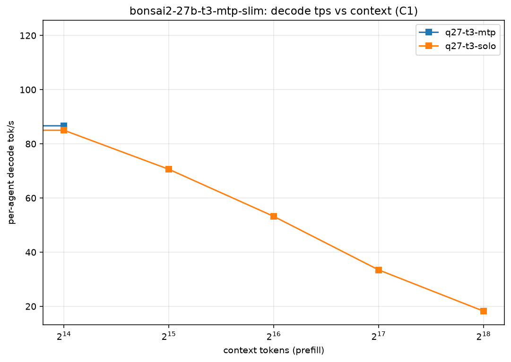
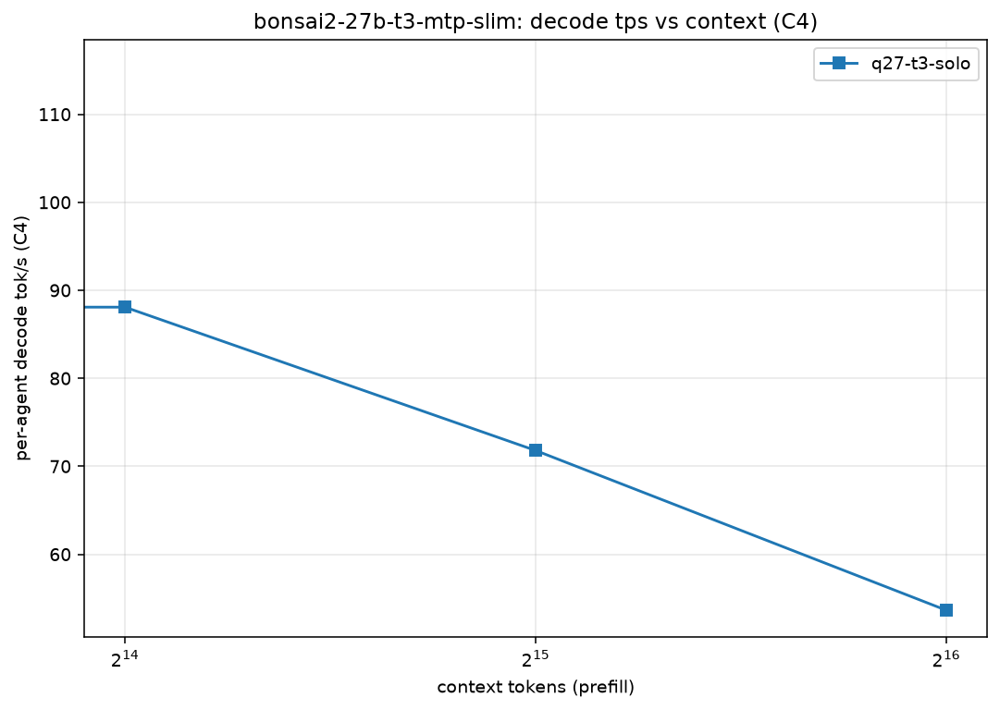
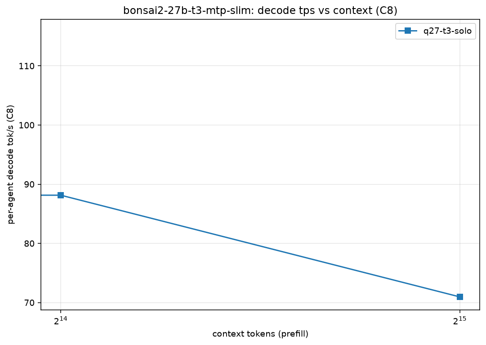
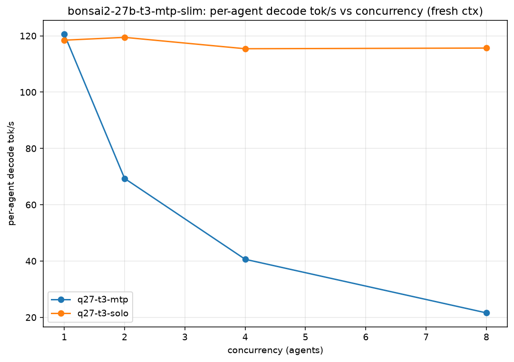

## /nix/store/795fmdnyi2152j30b9z2w9z9qv8gi29r-bonsai2-27b-gguf/share/bonsai2/Ternary-Bonsai-2-27B-PTQ1_0.gguf

### Screening (fresh context)

| engine | C1 | C2 | C4 | C8 | peak VRAM (MiB) |
|---|---|---|---|---|---|
| prism-ptq10 | 61.7 | 36.5 | 20.1 | 20.2 | 8690 |

### Long context (per-agent decode tok/s)

**16k**: C1: 0.0 t/s ← prism-ptq10

### Long context, C1 per-agent decode tok/s

| engine | 16k |
|---|---|
| prism-ptq10 | 0.0 |

### Plots

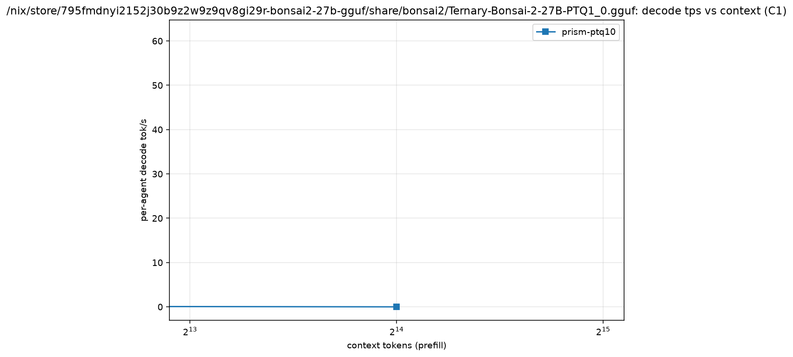
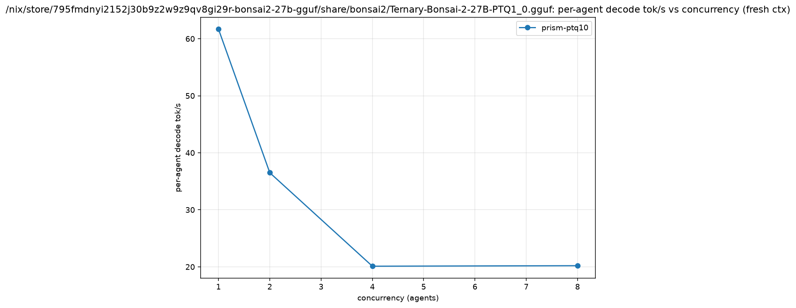

## bonsai2-27b

### Screening (fresh context)

| engine | C1 | C2 | C4 | C8 | peak VRAM (MiB) |
|---|---|---|---|---|---|
| ninfer-all-b2 | 267.5 | 194.0 | 111.2 | 61.8 | 12116 |

### Long context (per-agent decode tok/s)

**16k**: C1: 204.7 t/s ← ninfer-all-b2; C2: 100.3 t/s ← ninfer-all-b2; C4: 63.9 t/s ← ninfer-all-b2; C8: 40.1 t/s ← ninfer-all-b2

**32k**: C1: 225.8 t/s ← ninfer-all-b2; C4: 199.8 t/s ← ninfer-all-b2; C8: 210.9 t/s ← ninfer-all-b2

**64k**: C1: 197.9 t/s ← ninfer-all-b2; C4: 42.7 t/s ← ninfer-all-b2; C8: 24.6 t/s ← ninfer-all-b2

### Long context, C1 per-agent decode tok/s

| engine | 16k | 32k | 64k |
|---|---|---|---|
| ninfer-all-b2 | 204.7 | 225.8 | 197.9 |

### Plots


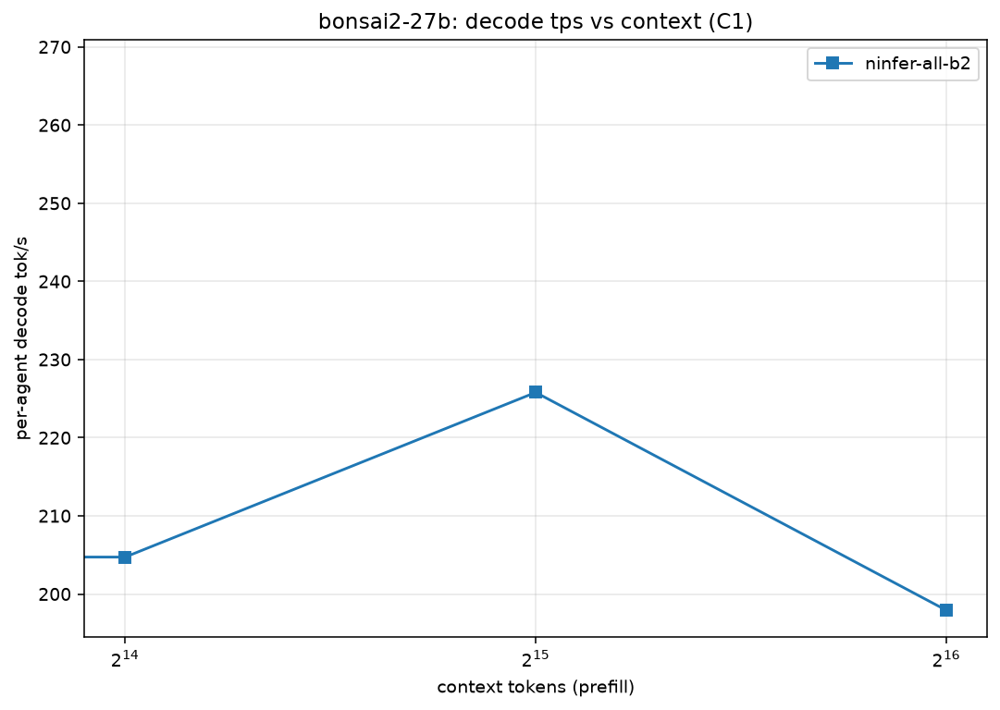

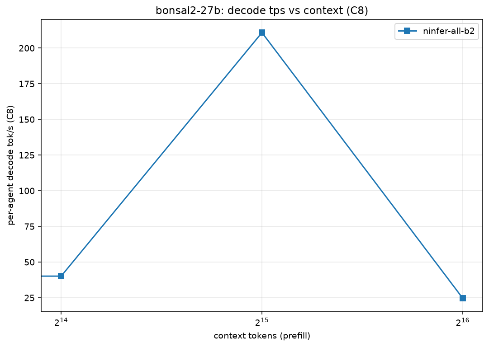


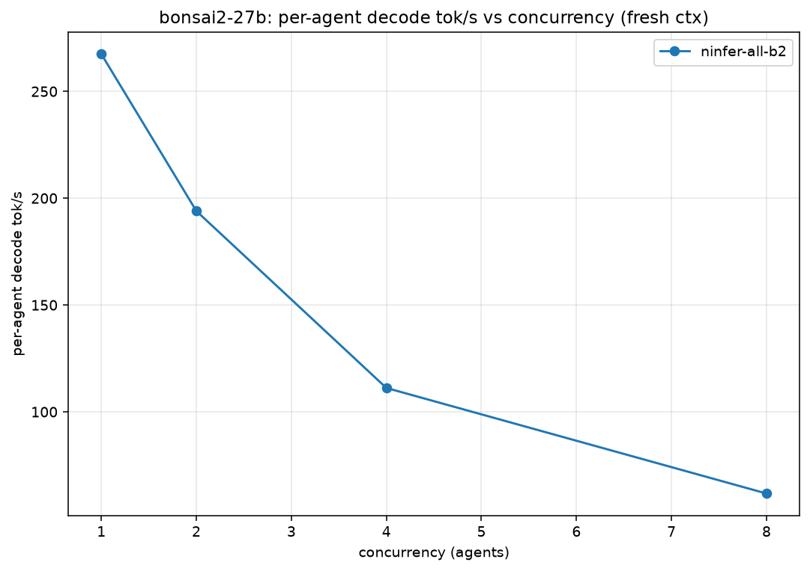

## qwen3.8-27b

### Screening (fresh context)

| engine | C1 | C2 | C4 | C8 | peak VRAM (MiB) |
|---|---|---|---|---|---|
| ashalliants-df2 | 162.7 | 154.3 | 157.9 | 155.7 | 23364 |
| ashalliants-mtp | 118.5 | 116.5 | 103.5 | 106.8 | 21634 |
| ninfer-061 | 70.9 | 49.2 | 24.6 | 22.9 | 22630 |

### Long context (per-agent decode tok/s)

**16k**: C1: 154.2 t/s ← ashalliants-df2; C2: 143.4 t/s ← ashalliants-df2; C4: 141.9 t/s ← ashalliants-df2; C8: 145.5 t/s ← ashalliants-df2

**32k**: C1: 135.0 t/s ← ashalliants-df2; C4: 144.5 t/s ← ashalliants-df2; C8: 139.0 t/s ← ashalliants-df2

**64k**: C1: 131.0 t/s ← ashalliants-df2; C4: 124.7 t/s ← ashalliants-df2; C8: 134.1 t/s ← ashalliants-df2

**128k**: C1: 118.2 t/s ← ashalliants-df2; C4: 118.5 t/s ← ashalliants-df2; C8: 117.2 t/s ← ashalliants-df2

**256k**: C1: 90.9 t/s ← ashalliants-df2; C4: 89.5 t/s ← ashalliants-df2; C8: 91.9 t/s ← ashalliants-df2

### Long context, C1 per-agent decode tok/s

| engine | 16k | 32k | 64k | 128k | 256k |
|---|---|---|---|---|---|
| ashalliants-df2 | 154.2 | 135.0 | 131.0 | 118.2 | 90.9 |
| ashalliants-mtp | 119.3 | — | — | — | — |
| ninfer-061 | 67.5 | — | — | — | — |

### Plots

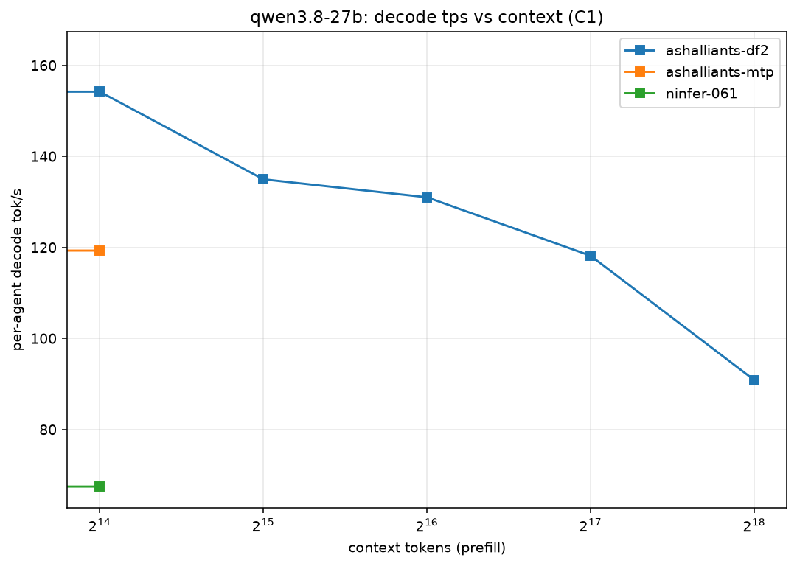
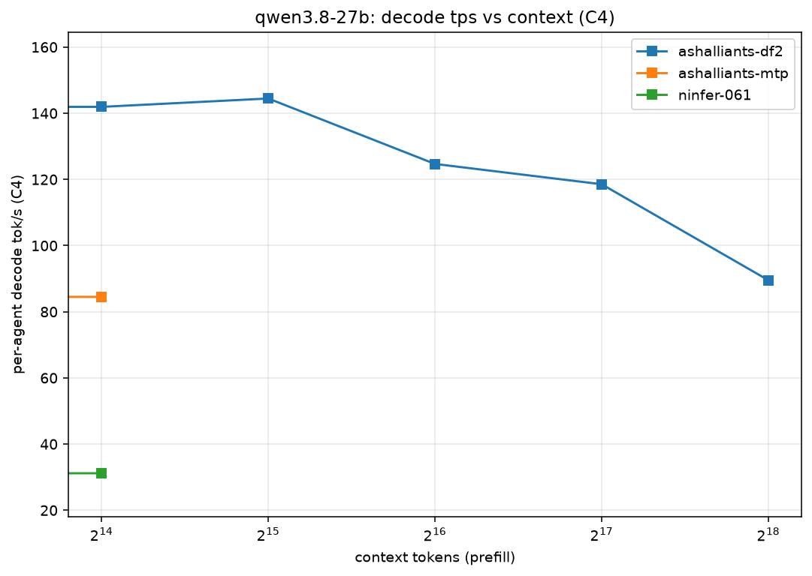
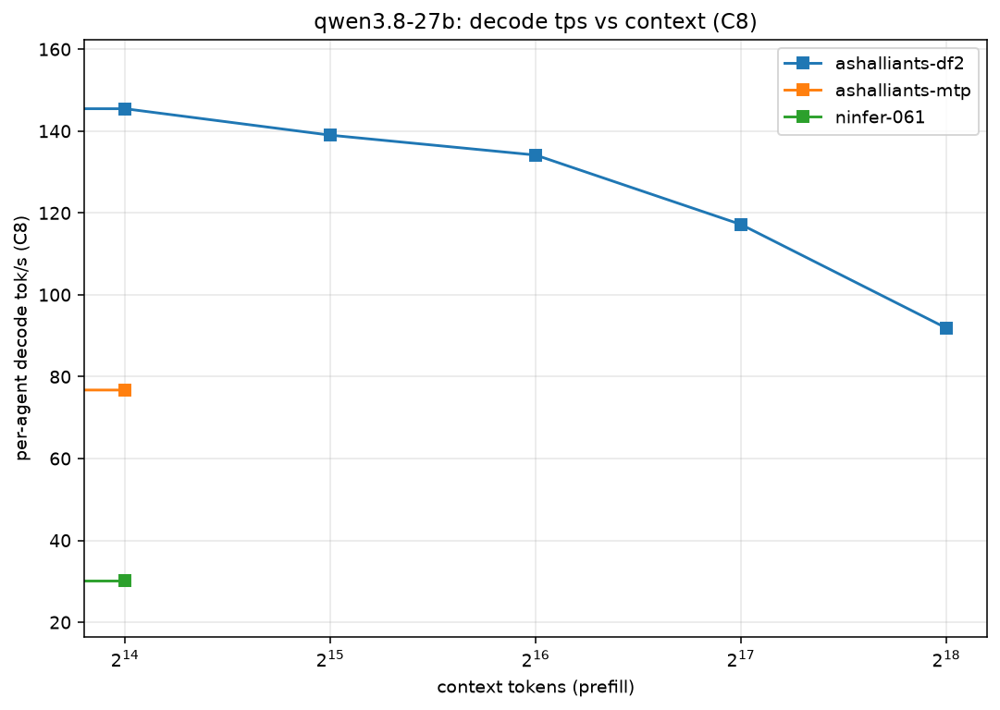
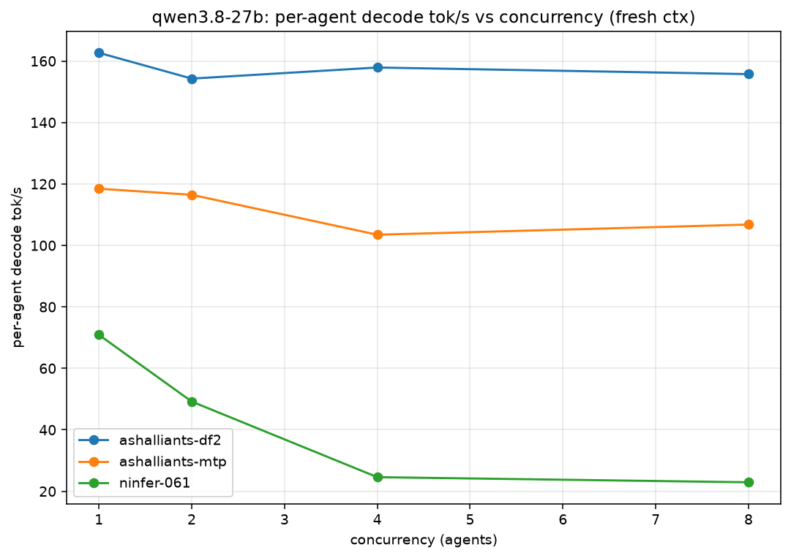

## Overflowed cells (not retried)

Concurrent long-context prefills that exceed host RAM (15 GiB, ~6 GiB free). Marked overflow per policy.

| engine | ctx | conc | reason |
|---|---|---|---|
| q27-t3-mtp | 16k | C4 | overflow: q27-t3-mtp 16K prefill x C4 exceeds host RAM |
| q27-t3-mtp | 16k | C8 | overflow: q27-t3-mtp 16K prefill x C8 exceeds host RAM |
| q27-t3-solo | 64k | C8 | overflow: q27-t3-solo ctx65536 x C8 = 524288 KV rows exceeds measured 400K host-RAM staging bound |
| q27-t3-solo | 128k | C4 | overflow: q27-t3-solo ctx131072 x C4 = 524288 KV rows exceeds measured 400K host-RAM staging bound |
| q27-t3-solo | 128k | C8 | overflow: q27-t3-solo ctx131072 x C8 = 1048576 KV rows exceeds measured 400K host-RAM staging bound |
| q27-t3-solo | 256k | C4 | overflow: q27-t3-solo ctx262144 x C4 = 1048576 KV rows exceeds measured 400K host-RAM staging bound |
| q27-t3-solo | 256k | C8 | overflow: q27-t3-solo ctx262144 x C8 = 2097152 KV rows exceeds measured 400K host-RAM staging bound |

## Pareto frontier (fresh ctx, per-agent tok/s)

**bonsai2-27b-t3-mtp-slim**: C1: 120.5 t/s ← q27-t3-mtp; C2: 119.5 t/s ← q27-t3-solo; C4: 115.4 t/s ← q27-t3-solo; C8: 115.7 t/s ← q27-t3-solo

**/nix/store/795fmdnyi2152j30b9z2w9z9qv8gi29r-bonsai2-27b-gguf/share/bonsai2/Ternary-Bonsai-2-27B-PTQ1_0.gguf**: C1: 61.7 t/s ← prism-ptq10; C2: 36.5 t/s ← prism-ptq10; C4: 20.1 t/s ← prism-ptq10; C8: 20.2 t/s ← prism-ptq10

**bonsai2-27b**: C1: 267.5 t/s ← ninfer-all-b2; C2: 194.0 t/s ← ninfer-all-b2; C4: 111.2 t/s ← ninfer-all-b2; C8: 61.8 t/s ← ninfer-all-b2

**qwen3.8-27b**: C1: 162.7 t/s ← ashalliants-df2; C2: 154.3 t/s ← ashalliants-df2; C4: 157.9 t/s ← ashalliants-df2; C8: 155.7 t/s ← ashalliants-df2

## Engine configurations

| engine | artifact | key flags |
|---|---|---|
| q27-t3-solo | `bonsai2-27b-t3-mtp-slim.q27` (q27 v0.14.4) | w8, spec-off, ctx 262144 |
| q27-t3-mtp | same | spec=mtp draft 3 |
| ninfer-all-b2 | `Ternary-Bonsai-2-27B-ninfer-v3.ninfer` (ghcr.io/iamwavecut/ninfer-all, sm86) | `--kv-dtype rk4v4 --spec dflash2 --draft-tokens 5 --no-prefix-reuse` (host KV pin avoided), ctx/kv 262144 |
| prism-ptq10 | `Ternary-Bonsai-2-27B-PTQ1_0.gguf` (prism llama.cpp) | PTQ1_0, flash-attn |
| ninfer-061 | `/var/lib/ninfer/qwen3_8_27b.ninfer` (ninfer 0.6.1) | ctx 65536 |
| ashalliants-df2 | `qwen3_8_27b.ninfer` (ashalliants 0.15.0) | spec=dflash2, ctx 262144, host KV clamped 8192→2048 MiB via `ninfer-serve.hostkv-shim` (oomd), full `LD_LIBRARY_PATH` from prism/nvidia-x11/ffmpeg/curl store paths |
| ashalliants-mtp | same | spec=mtp |

## Reproduce

```bash
cd benchmarks/engines-2026-10
python3 run_sweep.py --stage screening            # fresh+16K, C1-C8
python3 run_sweep.py --stage long --only ninfer-all-b2,q27-t3-solo,ashalliants-df2
.venv/bin/python analyze.py                       # CSV + PNG + frontier.json
.venv/bin/python report.py                        # this file
```
