# Inference engine benchmark — RTX 3090 (TB4 eGPU, SM86, 24 GB)

_Generated 2026-10-10 · harness: `benchmarks/engines-2026-10/` · metric: **per-agent decode tok/s** (chars/4.1 streaming proxy, engine-validated 2026-10-08) · greedy, 256 max tokens · GPU-resident weights/KV only (no CPU offload)._

## Summary

- **bonsai2-27b**: peak `ninfer-all-b2` 267.5 tok/s per-agent; at high parallelism×deep ctx — C8 × 32k: `ninfer-all-b2` 210.9 tok/s vs `q27-t3-solo` 71.0.
- **qwen3.8-27b**: peak `ashalliants-df2` 162.7 tok/s per-agent; at high parallelism×deep ctx — C8 × 256k: `ashalliants-df2` 91.9 tok/s vs `ashalliants-mtp` 66.9.
- **qwen38-27b-gguf**: peak `gguf-q4xs` 45.5 tok/s per-agent; at high parallelism×deep ctx — C8 × 32k: only `gguf-q4xs` measured (3.9 tok/s).
- **qwen38-27b-buun**: peak `buun-qwen` 43.1 tok/s per-agent; at high parallelism×deep ctx — C8 × 32k: only `buun-qwen` measured (2.1 tok/s).

Tables below show per-agent decode tok/s (rows = context, cols = C1–C8) and peak VRAM MiB per cell. `—` = not measured or overflow (see ledger).

## bonsai2-27b

### Table views (per-agent decode tok/s)

#### `ninfer-all-b2`

| context | C1 | C2 | C4 | C8 | peak VRAM (MiB) |
|---|---|---|---|---|---|
| fresh | 267.5 | 194.0 | 111.2 | 61.8 | 12116 |
| 16k | 204.7 | 100.3 | 63.9 | 40.1 | 12116 |
| 32k | 225.8 | — | 199.8 | 210.9 | 11950 |
| 64k | 197.9 | — | 42.7 | 24.6 | 15310 |

#### `prism-ptq10`

| context | C1 | C2 | C4 | C8 | peak VRAM (MiB) |
|---|---|---|---|---|---|
| fresh | 61.7 | 36.5 | 20.1 | 20.2 | 8690 |
| 16k | 0.0 | — | — | — | 8678 |
| 32k | 0.0 | — | — | — | 8780 |
| 64k | 0.0 | — | — | — | 8780 |
| 128k | 0.0 | — | — | — | 8780 |
| 256k | 0.0 | — | — | — | 8780 |

#### `q27-t3-mtp`

| context | C1 | C2 | C4 | C8 | peak VRAM (MiB) |
|---|---|---|---|---|---|
| fresh | 120.5 | 69.3 | 40.6 | 21.6 | 23028 |
| 16k | 86.7 | 47.6 | 25.9 | 13.6 | 23422 |
| 32k | 68.6 | — | 18.5 | 9.9 | 23310 |
| 64k | 54.6 | — | 12.6 | — | 23040 |
| 128k | 34.1 | — | — | — | 22902 |
| 256k | 20.8 | — | — | — | 24327 |

#### `q27-t3-solo`

| context | C1 | C2 | C4 | C8 | peak VRAM (MiB) |
|---|---|---|---|---|---|
| fresh | 118.5 | 119.5 | 115.4 | 115.7 | 22754 |
| 16k | 85.0 | 82.2 | 88.1 | 88.1 | 22727 |
| 32k | 70.6 | — | 71.8 | 71.0 | 22520 |
| 64k | 53.2 | — | 53.6 | — | 22520 |
| 128k | 33.5 | — | — | — | 22520 |
| 256k | 18.2 | — | — | — | 22520 |

### Plots

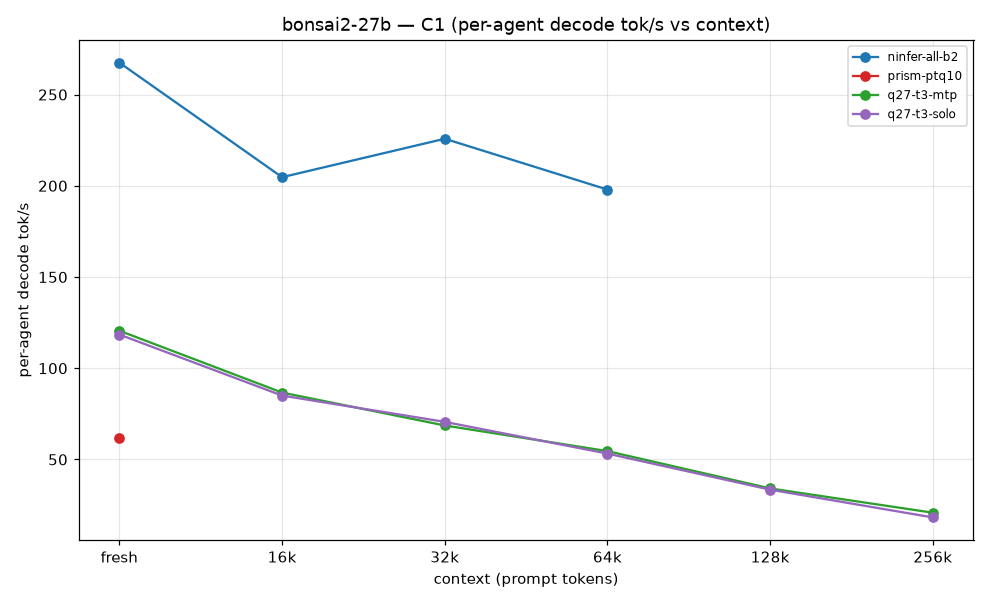
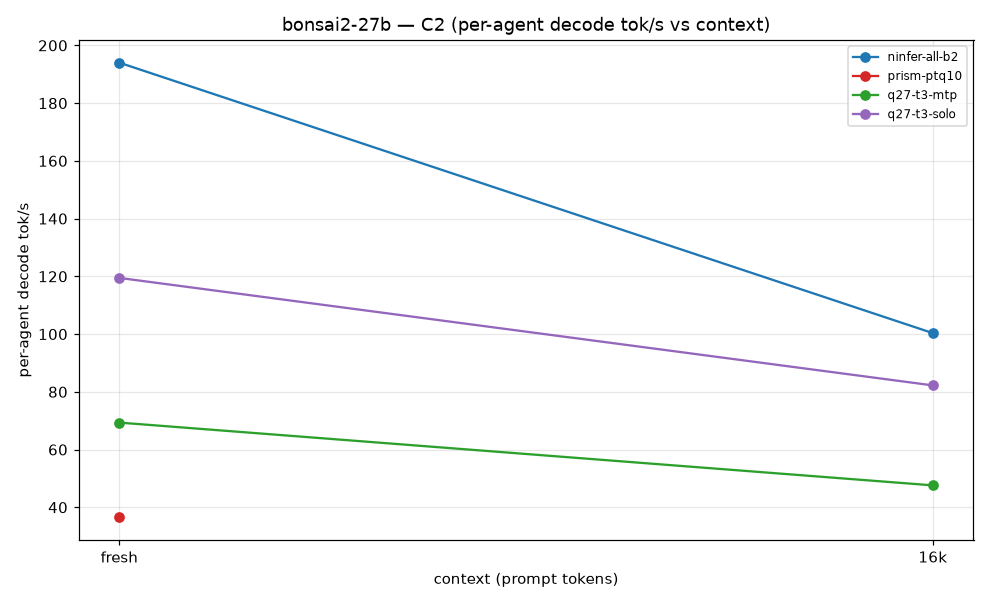
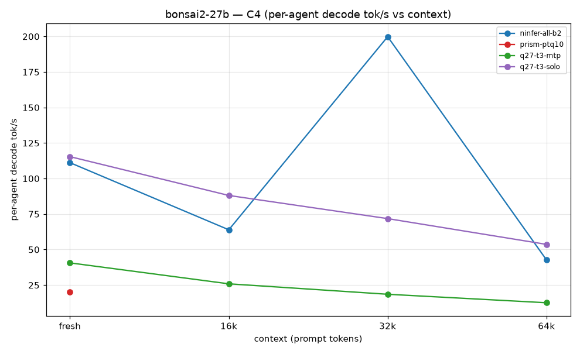
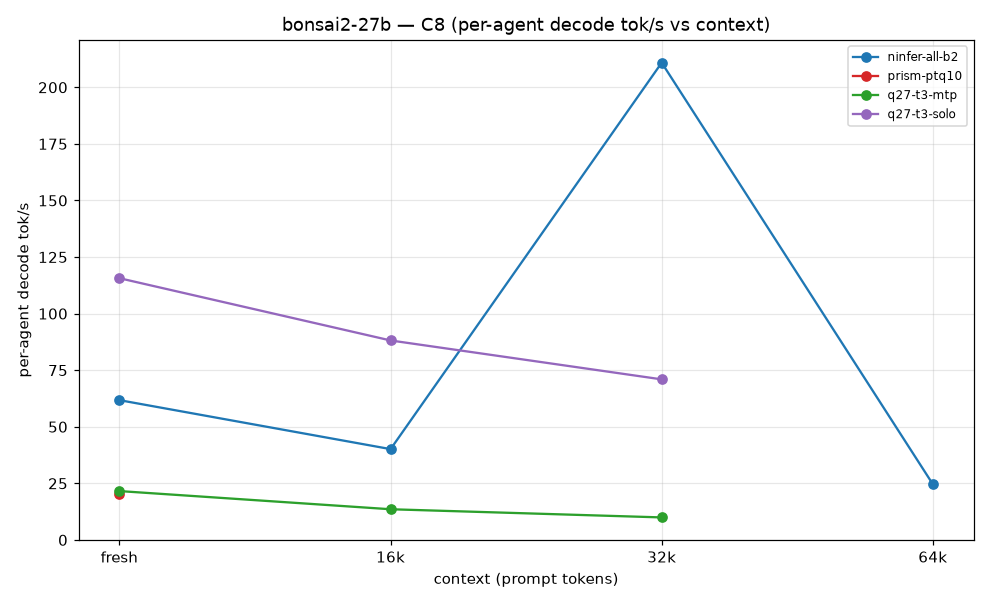

## qwen3.8-27b

### Table views (per-agent decode tok/s)

#### `ashalliants-df2`

| context | C1 | C2 | C4 | C8 | peak VRAM (MiB) |
|---|---|---|---|---|---|
| fresh | 162.7 | 154.3 | 157.9 | 155.7 | 23364 |
| 16k | 154.2 | 143.4 | 141.9 | 145.5 | 23374 |
| 32k | 135.0 | — | 144.5 | 139.0 | 23374 |
| 64k | 131.0 | — | 124.7 | 134.1 | 23374 |
| 128k | 118.2 | — | 118.5 | 117.2 | 23374 |
| 256k | 90.9 | — | 89.5 | 91.9 | 23374 |

#### `ashalliants-mtp`

| context | C1 | C2 | C4 | C8 | peak VRAM (MiB) |
|---|---|---|---|---|---|
| fresh | 118.5 | 116.5 | 103.5 | 106.8 | 21634 |
| 16k | 119.3 | 97.2 | 84.5 | 76.7 | 21644 |
| 32k | 110.5 | — | 78.8 | 74.9 | 21912 |
| 64k | 102.8 | — | 82.8 | 73.6 | 21912 |
| 128k | 88.0 | — | 72.3 | 67.6 | 21912 |
| 256k | 68.3 | — | 66.7 | 66.9 | 23528 |

#### `ninfer-061`

| context | C1 | C2 | C4 | C8 | peak VRAM (MiB) |
|---|---|---|---|---|---|
| fresh | 70.9 | 49.2 | 24.6 | 22.9 | 22630 |
| 16k | 67.5 | 30.8 | 31.2 | 30.1 | 22692 |
| 32k | 68.8 | — | 68.1 | 63.5 | 22734 |
| 64k | 66.2 | — | 66.3 | 61.2 | 22734 |
| 128k | 0.0 | — | — | — | 22732 |
| 256k | 0.0 | — | — | — | 22732 |

### Plots

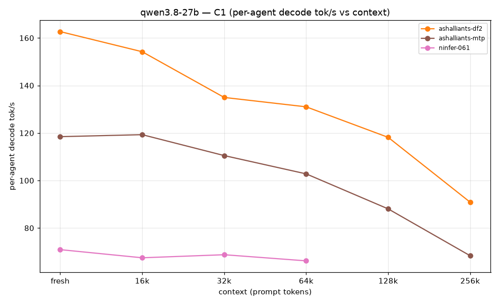
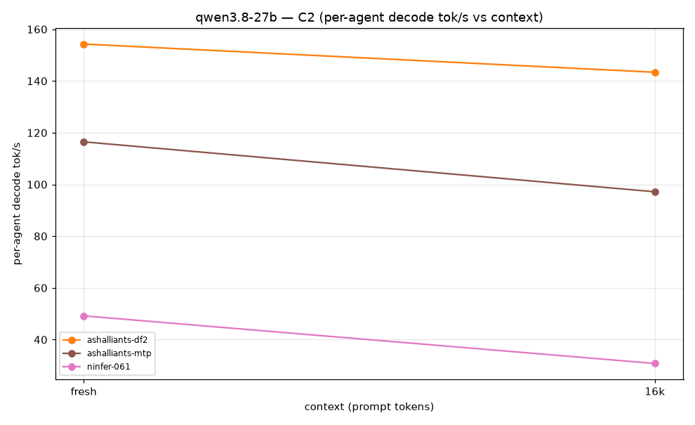
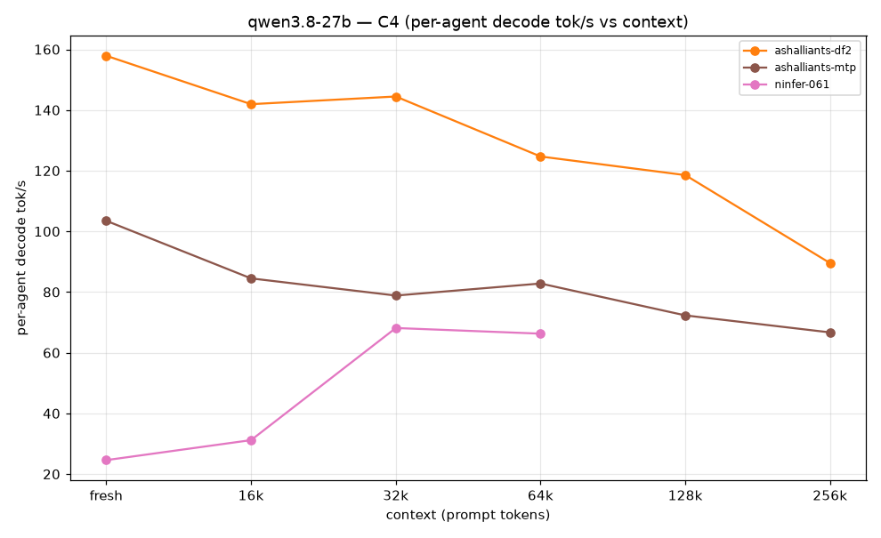
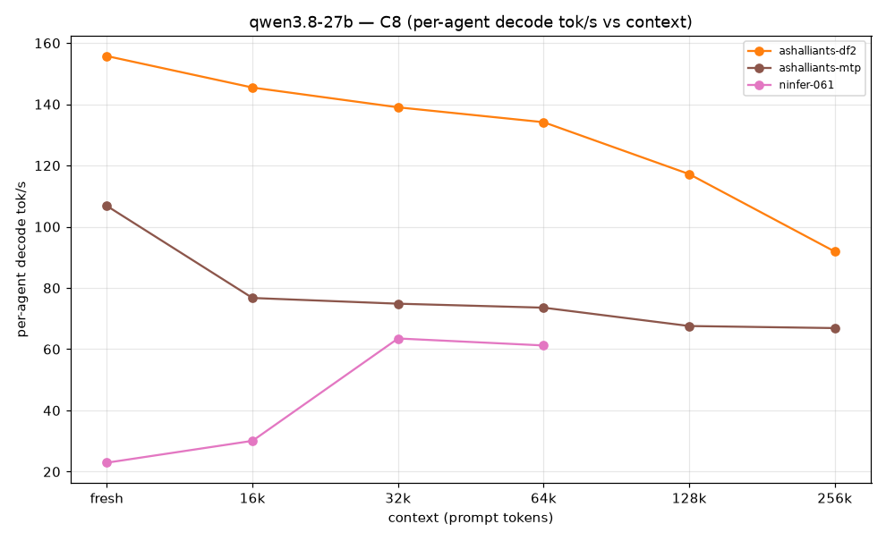

## qwen38-27b-gguf

### Table views (per-agent decode tok/s)

#### `gguf-q4xs`

| context | C1 | C2 | C4 | C8 | peak VRAM (MiB) |
|---|---|---|---|---|---|
| fresh | 45.5 | 38.5 | 27.8 | 16.6 | 26410 |
| 16k | 41.4 | 23.9 | 12.1 | 5.8 | 26414 |
| 32k | 37.9 | — | 8.4 | 3.9 | 24360 |

### Plots

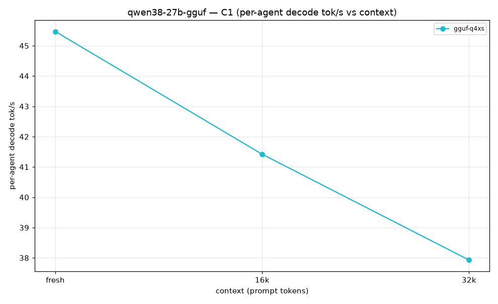

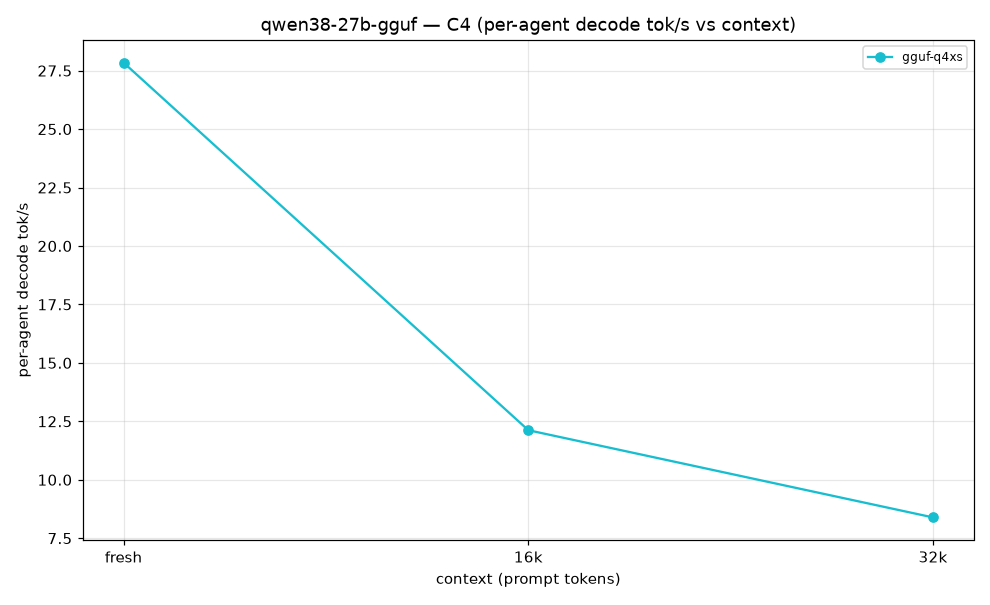
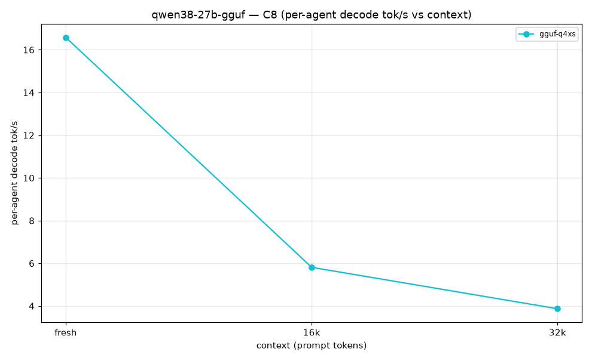

## qwen38-27b-buun

### Table views (per-agent decode tok/s)

#### `buun-qwen`

| context | C1 | C2 | C4 | C8 | peak VRAM (MiB) |
|---|---|---|---|---|---|
| fresh | 43.1 | 35.9 | 25.2 | 15.2 | 19978 |
| 16k | 34.1 | 17.4 | 8.1 | 3.8 | 19986 |
| 32k | 28.7 | — | 4.8 | 2.1 | 19986 |
| 64k | 21.8 | — | 2.8 | 0.0 | 19984 |

### Plots

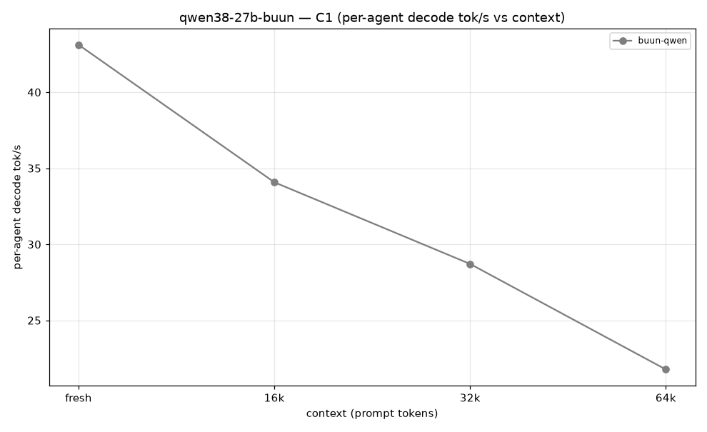
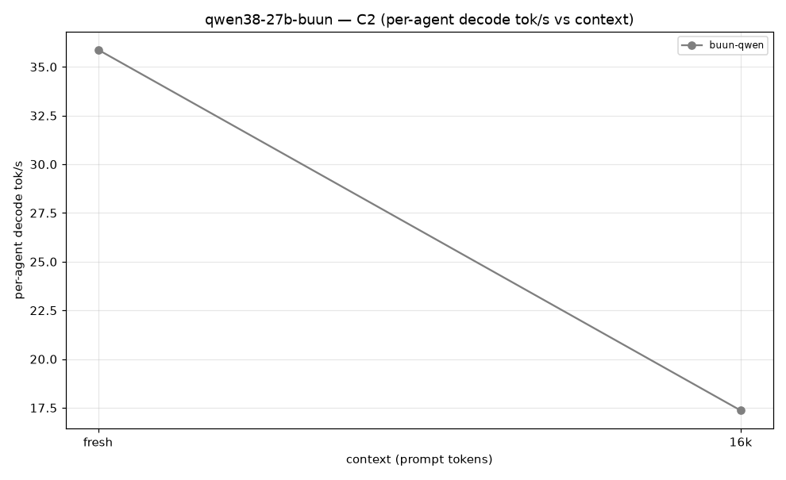
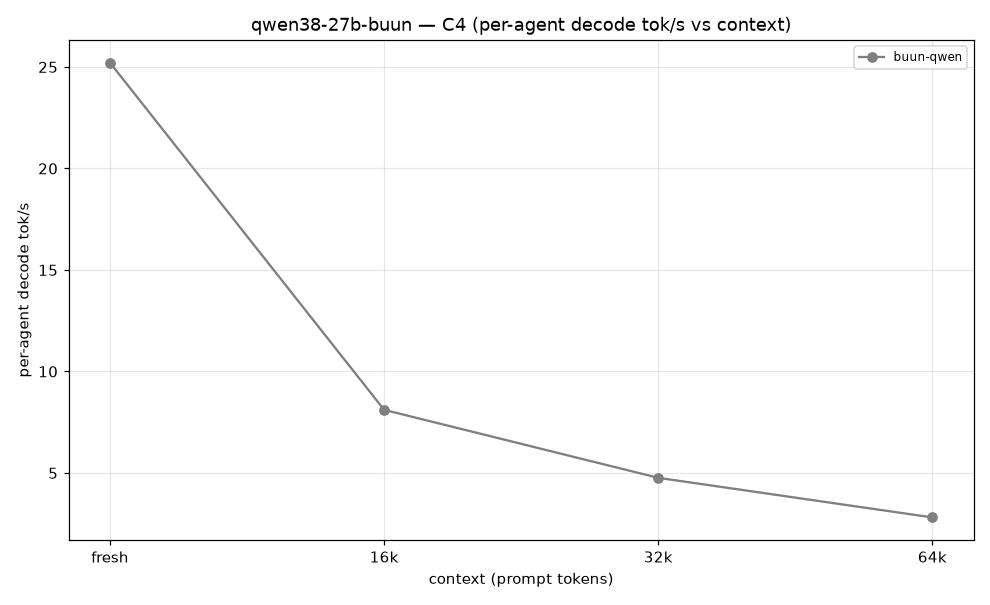
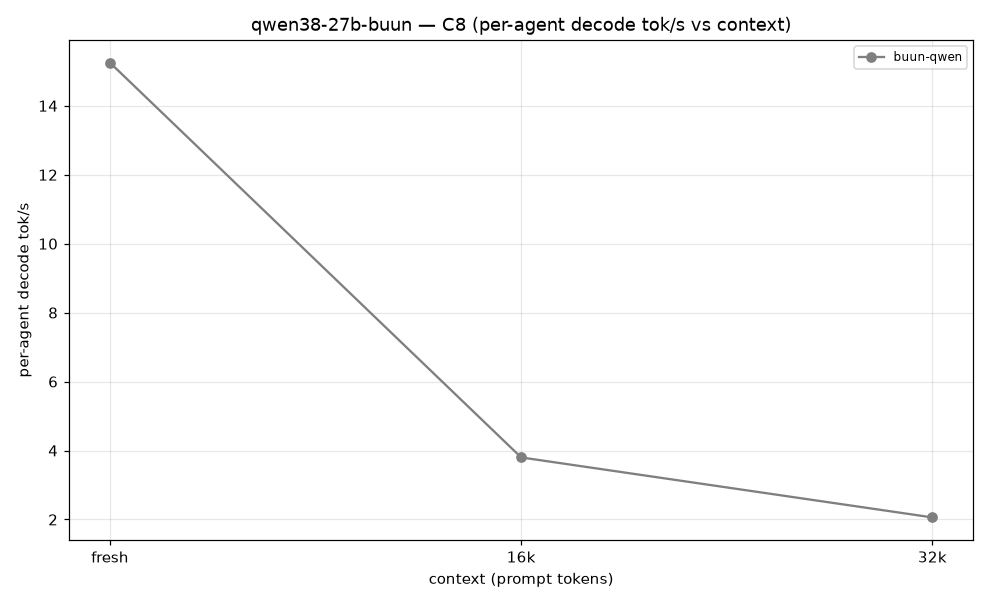

## Overflowed cells (retried once 2026-10-09; permanent rejections kept)

_None outstanding._

## Engine configurations

| engine | artifact | key flags |
|---|---|---|
| q27-t3-solo | `bonsai2-27b-t3-mtp-slim.q27` (q27 v0.14.4) | w8, spec-off, ctx 262144 |
| q27-t3-mtp | same | spec=mtp draft 3 |
| ninfer-all-b2 | `Ternary-Bonsai-2-27B-ninfer-v3.ninfer` (ghcr.io/iamwavecut/ninfer-all, sm86) | `--kv-dtype rk4v4 --spec dflash2 --draft-tokens 5 --no-prefix-reuse`, ctx/kv 262144 |
| prism-ptq10 | `Ternary-Bonsai-2-27B-PTQ1_0.gguf` (prism llama.cpp) | PTQ1_0, flash-attn |
| ninfer-061 | `/var/lib/ninfer/qwen3_8_27b.ninfer` (ninfer 0.6.1) | ctx 65536 |
| ashalliants-df2 | `qwen3_8_27b.ninfer` (ashalliants 0.15.0) | spec=dflash2, ctx 262144, host KV clamped 2048 MiB via shim |
| ashalliants-mtp | same | spec=mtp |

## Reproduce

```bash
cd benchmarks/engines-2026-10
python3 run_sweep.py --stage screening            # fresh+16K, C1-C8
python3 run_sweep.py --stage long                 # survivors, 32K-256K
.venv/bin/python analyze.py                       # CSV + plots
.venv/bin/python report.py                        # this file
```